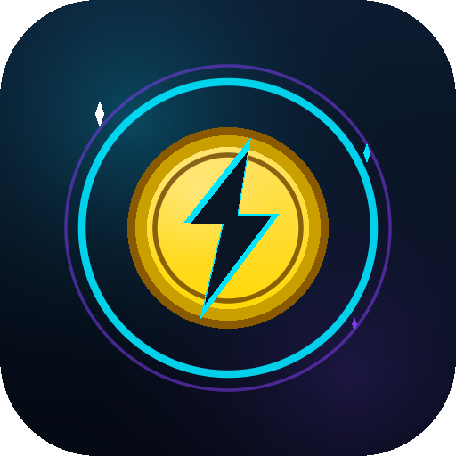

<div align="center">



# SKYBOUND: COIN RUSH

**A 2D landscape endless runner for Android — every sprite, shader, sound and screen is generated at runtime.**

[](https://unity.com)
[](#-download--install)
[](#-build-from-source)
[](#-build-from-source)
[](#-gameplay)
[](#-download--install)

[Download APK](../../releases/latest) · [Controls](#-controls) · [Build it yourself](#-build-from-source) · [Architecture](#-architecture) · [Troubleshooting](#-troubleshooting)

</div>

---

## 📖 Table of contents

1. [Overview](#-overview)
2. [Download & install](#-download--install)
3. [Controls](#-controls)
4. [Gameplay](#-gameplay)
5. [Progression & economy](#-progression--economy)
6. [World & presentation](#-world--presentation)
7. [Audio](#-audio)
8. [Architecture](#-architecture)
9. [Save data](#-save-data)
10. [Build from source](#-build-from-source)
11. [Testing](#-testing)
12. [Troubleshooting](#-troubleshooting)
13. [Performance & optimisation](#-performance--optimisation)
14. [Known limitations](#-known-limitations)
15. [Roadmap](#-roadmap)
16. [Originality & asset policy](#-originality--asset-policy)
17. [Credits & licence](#-credits--licence)

---

## 🎮 Overview

**Skybound: Coin Rush** is a complete, self-contained Android runner inspired by the
endless-runner genre but built entirely from original, procedurally generated content.
There are **no imported textures, models, fonts, music tracks or sound effects** — the game
creates all of them in code the first time it boots.

| | |
| --- | --- |
| **Engine** | Unity 6000.4.4f1 (URP 2D, Linear colour space) |
| **Platform** | Android 7.1 (API 25) and newer |
| **Architecture** | ARM64 (`arm64-v8a`) |
| **Scripting backend** | IL2CPP, Release, managed stripping **Low** |
| **Orientation** | Landscape (left / right auto-rotate, portrait disabled) |
| **Graphics API** | OpenGL ES 3 |
| **Package** | `com.skybound.coinrush` |
| **Version** | `1.0.0` (version code 1) |
| **APK size** | ~35 MB |
| **Reference resolution** | 1920 × 1080, safe-area aware |

### Why everything is generated at runtime

The project deliberately avoids an authoring pipeline for art and audio:

- The repository stays small and has no binary asset dependency chain.
- Every visual can be recoloured globally by the theme system.
- The game boots on any Android device without texture-import settings being wrong.
- It demonstrates how far a runner can be taken with pure code.

The only authored binary asset is the launcher icon (`Assets/Art/AppIcon.png`), which is
itself produced by an editor script from the same palette and coin/bolt artwork.

---

## 📥 Download & install

The latest build is attached to the **[Releases page](../../releases/latest)**.

| File | Size | Notes |
| --- | --- | --- |
| `SkyboundCoinRush-1.0.0.apk` | ~35 MB | Signed with the Android debug key, installable by sideloading |

### Install steps

1. Download the APK on your phone (or copy it over USB / a cloud drive).
2. Tap the file and allow **Install unknown apps** for the app you opened it with.
3. If Play Protect warns you (the APK is not from the Play Store), choose **Install anyway**.
4. Open **Skybound: Coin Rush**.

**Requirements**

- Android **7.1 or newer**.
- A **64-bit ARM (ARM64)** phone — effectively every phone released in the last several years.
- About **100 MB** of free storage (APK + extracted libraries + save data).

> **No AAB is produced.** The project is configured for direct APK sideloading. The optional
> Play Store AAB build target exists in the editor menu but is not part of this release.

### First launch

The first launch shows a **SKYBOUND / COIN RUSH** loading screen while the city, procedural
audio and UI are generated. On a slow phone this can take up to **~30 seconds**. The boot is
staged across frames so Android's "app isn't responding" watchdog is not triggered.

---

## 🕹 Controls

| Action | Touch | Keyboard (editor / desktop) |
| --- | --- | --- |
| Change lane | **Swipe left / right** | `A` / `D` or `←` / `→` |
| Jump | **Swipe up** | `W`, `↑` or `Space` |
| Slide | **Swipe down** | `S`, `↓`, `Left Ctrl` or `Left Shift` |
| Pause | **Pause button** (top-right) | `Esc` or `P` |
| Skip tutorial | Tap the tutorial panel | Any key |

Swipes use a forgiving threshold (`max(38 px, 3.2 % of screen height)`) and a 0.9 s gesture
window, so quick taps and short flicks are both accepted. Mouse drag is supported for editor
testing.

**Optional on-screen controls** — large left / right / jump / slide buttons can be enabled in
**Settings → On-Screen Controls**. They are useful on devices where system gestures interfere
with vertical swipes.

---

## 🎯 Gameplay

### Core loop

- **Three lanes** with smooth interpolation, lean and banking animation.
- Pseudo-3D projection drawn with 2D sprites: world `z` is mapped to screen `x`, `y` and
  scale, producing depth without a 3D pipeline.
- **Jump**, **slide**, coyote time, jump buffering and slide buffering for responsive input.
- Forward speed ramps from **13.5 to 31 units/s**, with per-level base speeds.
- Score is driven by distance, speed, coins, combo multiplier and active power-ups.
- Tracked per run: distance, score, coins, best combo, near misses, jumps, slides and time.

### Coins and combo

| Coin | Value | Appearance |
| --- | --- | --- |
| Bronze | 1 | Warm copper |
| Silver | 3 | Cool silver |
| Gold | 5 | Classic gold |
| Special | 10 | Magenta neon star |

- The **Coin Magnet** pulls coins toward the player; its radius improves with shop upgrades.
- The **combo meter** grows as coins are collected and decays when collection stops.
- Combo directly multiplies coin score and can trigger a combo-break toast.
- Collecting coins and near-missing hazards feed the mission and achievement systems.

### Obstacles and hazards

- **Low barriers** — jump over them.
- **Overhead gates** — slide underneath.
- **Full blockers** — change lane.
- **Moving hazards** and traffic patterns in later levels.
- **Gap segments** where the skyway ends without warning.
- **Sky Hunter** — a chasing drone that telegraphs attacks and can be escaped.
- **Near-miss detection** rewards risky dodges with score and combo.
- A **Sky Shield** absorbs one collision; otherwise the run ends or the player may revive.

### Power-ups

| Power-up | Effect | Base duration |
| --- | --- | --- |
| 🧲 Coin Magnet | Pulls nearby coins toward the player | 10 s |
| 🛡 Sky Shield | Blocks one collision | 12 s |
| 🚀 Turbo Boost | Speed burst | 6 s |
| 🪙 Double Coins | 2× coin value | 12 s |
| ⭐ Score Surge | 2× score gain | 12 s |
| ⏳ Time Warp | Slows the world | 4 s |

Re-collecting an active power-up **extends its duration by 35 %**. Timers are shown on the HUD
with animated bars.

### Revive

- One revive per run, costing **150 coins**.
- Revive clears nearby hazards, grants brief invulnerability and resumes the run.
- Declining finalises the run and opens the results screen with a breakdown and new-best badges.

### Endless and level modes

**Endless mode** generates segments procedurally, increases difficulty over time and rotates
themes and weather.

**Level mode** contains **8 hand-authored definitions** with distance goals, target speed,
difficulty, star thresholds and fixed themes:

| # | Level | Distance | Theme | Weather |
| --- | --- | --- | --- | --- |
| 1 | City Run | 550 m | Day | Clear |
| 2 | Sky Bridge | 750 m | Sunset | Clear |
| 3 | Neon District | 950 m | Night | Cloudy |
| 4 | Storm Zone | 1,150 m | Storm | Storm |
| 5 | Skyline | 1,350 m | Sunset | Fog |
| 6 | Cyber Metro | 1,550 m | Night | Rain |
| 7 | Cloud City | 1,800 m | Day | Cloudy |
| 8 | Final Skyway | 2,100 m | Neon Night | Storm |

Levels award **1–3 stars** based on score thresholds (target distance × 10, × 1.25, × 1.75).
Stars are saved and displayed in level select.

---

## 📈 Progression & economy

| System | Details |
| --- | --- |
| **XP / player level** | XP earned from runs; each level-up grants a coin reward. |
| **Characters (4)** | Nova (free), Blaze (3,200), Aero (4,800), Shadow (7,200). Each has speed / jump / recovery multipliers. |
| **Skins (7)** | Street (free), Cyber, Neon, Shadow, Golden, Future, Storm. Each defines primary / secondary / accent colours for the procedural runner rig. |
| **Sky Shop** | Buy characters and skins, equip them, and upgrade Magnet / Shield / Boost / Coin Booster levels. |
| **Daily missions** | A rotating pool of 14 objective types with progress, rewards and claim state, persisted per day. |
| **Achievements** | 12 long-term goals with progress bars, coin rewards and unlock banners. |
| **Best scores** | Best score, distance, coins, combo and time are stored. |
| **Tutorial** | Six swipe / collect prompts on the first run; skippable and re-enableable in Settings. |

All economy values live in `Assets/Scripts/Core/GameConfig.cs`, which makes balancing a
single-file change.

---

## 🌆 World & presentation

- **Procedural skyline** with multiple parallax layers, lit windows and neon depth.
- **Skyway renderer** with animated lane dashes, edge glow and speed streaks.
- **Themes** — day, sunset, night, storm and neon — with smooth palette transitions.
- **Weather** — rain, fog, lightning flashes, stars, clouds and drifting ambient particles.
- **VFX** — screen shake, hit flash, coin bursts, dust, sparks and pickup trails.
- **Camera rig** — menu framing, gameplay framing, speed zoom, game-over pull-back and shake.
- **Quality presets** (Low / Medium / High / Ultra) tune particle counts, parallax density,
  VFX budgets and target FPS. Auto-quality samples frame time and steps quality up/down with
  hysteresis.

---

## 🔊 Audio

`ProceduralAudio` synthesises every clip at boot — there are no audio files in the project:

- Separate music loops for **menu**, **run**, **intense / storm** and **results**.
- SFX for coin pickup (pitch rises with combo), gold coin, jump, land, slide, hit, shield,
  boost, magnet, power-up, click, purchase, achievement, game over and level complete.
- Voice-style synth stings for countdowns and callouts.
- Logical **Master / Music / SFX / Voice** buses with volume settings, pause ducking and fades.

Audio is fully optional: if no output device is available (CI, batch mode, muted phone),
the game continues silently.

---

## 🏗 Architecture

```
Assets/
  Scenes/
    Skybound.unity                    Bootstrap scene (contains GameBootstrap only)
    SampleScene_2D_Backup.unity       Original 2D prototype (kept as a backup)
  Art/
    AppIcon.png                       Generated launcher icon
    Shaders/SkyboundAdditive.shader   Additive sprite shader
    Shaders/SkyboundGradient.shader   Sky gradient shader
  Editor/
    SkyboundBuildTools.cs             Setup, icon, scene generation, APK/AAB builds
    SkyboundSmokeTest.cs              Headless play-mode smoke test
  Scripts/
    GameBootstrap.cs                  Entry point, staged boot, loading/error overlay
    GameManager.cs                    State machine, run lifecycle, scoring, revive, levels
    Coin.cs                           Coin behaviour and values
    Core/
      GameConfig.cs                   All data: levels, missions, achievements, shop, palette
      Palette.cs                      Colour palette and theme colours
      Art.cs                          Runtime sprites, textures and materials
      Projection.cs                   Pseudo-3D world-to-screen projection
      RuntimeUtil.cs                  GameObject / sprite / glow helpers
      RunSummary.cs                   Result payload
    SaveSystem/SaveManager.cs         JSON persistence, economy, unlocks, run recording
    Audio/
      AudioManager.cs                 Buses, crossfades, pause ducking, haptics
      ProceduralAudio.cs              Music and SFX synthesis
    Camera/CameraRig.cs               Menu / gameplay / game-over framing, shake, zoom
    Player/
      PlayerController.cs             Movement, jump, slide, collisions
      PlayerInput.cs                  Touch-first swipes + keyboard fallback
      PlayerAnimator.cs               Procedural limb, scarf and lean animation
    World/
      EndlessWorld.cs                 Segment spawning, coins, obstacles, hazards
      EnvironmentController.cs        Sky, theme, weather and parallax environment
      ParallaxCity.cs                 Skyline layers and building sprites
      RoadRenderer.cs                 Skyway, lane dashes, edge glow, streaks
    Obstacles/Obstacle.cs             Procedural obstacle visuals and hitboxes
    Enemies/SkyHunter.cs              Chasing drone, telegraphs and escape logic
    PowerUps/PowerUpPickup.cs         Pickup visuals and collection
    Managers/                         Score, Combo, PowerUp, Mission, Achievement, Level, Quality
    VFX/VFXManager.cs                 Pooled sprite-particle effects
    Optimization/QualityManager.cs    Quality presets and adaptive frame pacing
    UI/
      UIManager.cs                    All screens, HUD, overlays, toasts
      UIFactory.cs                    UGUI / TextMesh Pro builders
      PowerRowUI.cs                   Power-up timer rows
    Legacy/                           Archived prototype scripts (not used)
```

### Boot sequence

```
GameBootstrap
  → ConfigureApplication (landscape, 60 FPS, no sleep)
  → SaveManager
  → AudioManager
  → GameManager.BuildRoutine (staged coroutine)
       camera → skyline → road + environment → managers →
       track → runner → UI screens → menu
  → GameBootstrap.NotifyReady
```

The boot is deliberately **staged across frames** with a native `OnGUI` loading overlay.
If any phase throws, the overlay switches to a red **STARTUP ERROR** panel showing the
exception on screen, and writes the details plus device information to
`skybound_boot.log` in the persistent data directory.

### State machine

`GameState`: `Boot`, `Menu`, `Playing`, `Paused`, `GameOver`, `LevelComplete`, `Revive`.

Only `GameManager` changes state. UI, audio and world systems react through events
(`StateChanged`, `RunFinished`, `PowerUpActivated`, `HitTaken`, `ToastRequested`, …), which
keeps the screens decoupled from gameplay logic.

### Rendering

- URP 2D renderer in **linear** colour space.
- Every sprite is a runtime `Texture2D`/`Sprite` cached by `Art`.
- Sprite renderers use explicit sorting orders; no per-frame material allocation.
- Two custom shaders handle additive glow and the sky gradient. They are listed in
  **Graphics Settings → Always Included Shaders** so IL2CPP builds cannot strip them — a
  shader that is never referenced by an asset is removed from the player and would otherwise
  render a magenta sky on device.

---

## 💾 Save data

Saved as JSON at:

```
<Application.persistentDataPath>/skybound_save.json
```

On Android this is normally:

```
/storage/emulated/0/Android/data/com.skybound.coinrush/files/skybound_save.json
```

The boot log is written next to it as `skybound_boot.log`.

- Atomic write via a temporary file and replacement.
- Autosave every few seconds plus save on pause and quit.
- Version field for forward migration.
- Missing or corrupt data falls back to safe defaults instead of crashing.

Tracked values include coins, XP, player level, selected character and skin, unlocks, level
stars, tutorial flags, daily mission state, achievement state, best scores, lifetime totals,
purchases, power-up upgrade levels and every setting.

---

## 🔨 Build from source

### Prerequisites

- **Unity 6000.4.4f1** with **Android Build Support**
  (SDK, NDK and OpenJDK components installed through Unity Hub).
- Windows, macOS or Linux. The build tooling auto-detects the SDK at
  `%LOCALAPPDATA%\Android\Sdk` and a JDK under `%ProgramFiles%\Java`, or honours
  `ANDROID_SDK_ROOT` / `JAVA_HOME`.
- For Play Store uploads, configure your own keystore in
  **Project Settings → Player → Publishing Settings**.

### Open the project

1. Unity Hub → **Add project** → select this repository folder.
2. Open `Assets/Scenes/Skybound.unity`.
3. Press **Play**.

`GameBootstrap` also has a `[RuntimeInitializeOnLoadMethod]` fallback, so the game still boots
if the scene is empty.

### Editor menu

| Menu item | Purpose |
| --- | --- |
| `Skybound / Setup / Apply All` | Applies Android settings, regenerates the icon and the bootstrap scene, and configures always-included shaders. |
| `Skybound / Setup / Generate App Icon` | Rebuilds `Assets/Art/AppIcon.png`. |
| `Skybound / Setup / Generate Bootstrap Scene` | Rebuilds `Assets/Scenes/Skybound.unity` and the build-scene list. |
| `Skybound / Setup / Configure Android Player Settings` | Applies package id, version, IL2CPP, ARM64, landscape, stripping and graphics API. |
| `Skybound / Build / Android APK` | Builds `Builds/Android/SkyboundCoinRush-1.0.0.apk`. |
| `Skybound / Build / Android AAB (Play Store)` | Optional: builds an `.aab`. Not part of this release. |

### Command line

```powershell
$unity = "C:\Program Files\Unity\Hub\Editor\6000.4.4f1\Editor\Unity.exe"
$project = "C:\Path\To\My project"

& $unity -batchmode -nographics `
  -projectPath $project `
  -executeMethod Skybound.Editor.SkyboundBuildTools.BuildApk `
  -logFile "apk-build.log"
```

Output:

```
Builds/Android/SkyboundCoinRush-1.0.0.apk
```

Unity also creates a sibling folder named
`..._BackUpThisFolder_ButDontShipItWithYourGame` (generated IL2CPP C++ and symbols). It is
**not** part of the APK and must not be shipped; it is ignored by `.gitignore`.

> IL2CPP + Burst compilation is CPU-heavy. The first build can take **30–60 minutes** on a
> laptop; later incremental builds are much faster.

### Applied player settings

| Setting | Value |
| --- | --- |
| Product | `Skybound: Coin Rush` |
| Company | `Skybound Studio` |
| Package | `com.skybound.coinrush` |
| Version | `1.0.0` (version code 1) |
| Orientation | Landscape left / right, portrait disabled |
| Scripting backend | IL2CPP |
| IL2CPP configuration | Release |
| Architectures | ARM64 |
| Min / target SDK | 25 / automatic (currently 36) |
| Graphics API | OpenGL ES 3 |
| Colour space | Linear |
| Managed stripping | Low |
| Always-included shaders | `Skybound/Gradient`, `Skybound/AdditiveSprite`, `Sprites/Default`, `UI/Default` |

---

## 🧪 Testing

A headless play-mode smoke test boots the generated scene, starts a run, exercises pause /
resume, input, forced game over, revive decline, results and every menu screen, and fails on
any runtime exception.

```powershell
& $unity -batchmode -nographics `
  -projectPath $project `
  -executeMethod Skybound.Editor.SkyboundSmokeTest.Run `
  -logFile "smoke.log"
```

Expected log:

```
[Smoke] Boot OK ...
[Smoke] Run active ...
[Smoke] Results ...
[Smoke] Menu and all overlay screens built successfully.
[Smoke] PASS ...
```

Exit code **0** means success. The test disables domain reload while it runs so the editor tick
survives the play-mode transition, then restores the setting.

### What the test covers

- Staged boot completes and `GameManager.IsBuilt` becomes true.
- Save data and audio services exist.
- Distance, speed and score advance during a run.
- The main menu is hidden while a run is active and while paused.
- Pause freezes `Time.timeScale`, resume restores it.
- Lane change, jump and slide are accepted.
- Game-over transitions to the revive offer; the REVIVE and GIVE UP buttons are not
  covered by an overlay, clicking REVIVE resumes the run and charges the coin cost,
  and clicking GIVE UP after the one allowed revive finalises the run and shows results.
- The shop, level select, missions, achievements and settings screens all build and rebuild
  without exceptions.

---

## 🩺 Troubleshooting

| Symptom | Meaning / fix |
| --- | --- |
| **Loading screen with a progress bar** | Normal first launch. The city, audio and UI are generated procedurally. Wait up to ~30 s on slow hardware. |
| **Red STARTUP ERROR panel** | The app caught a runtime exception. The panel shows the exception and stack; a copy is in `skybound_boot.log`. Screenshot it and open an issue. |
| **Menu appears but swipes do nothing** | Enable **Settings → On-Screen Controls**, or check the phone's system gesture settings that may swallow vertical swipes. |
| **Phone shows a red X / "isn't responding"** | Android's ANR watchdog. This build stages startup across frames to avoid it. Close other apps to free RAM and relaunch. |
| **Solid dark-blue sky instead of a gradient** | The custom sky shader was not loaded; the game falls back to the camera clear colour. The build now forces both shaders into the player. |
| **"App not installed"** | Usually a signature or architecture mismatch: uninstall the previous copy and confirm the phone is ARM64. |
| **Play Protect warning** | Expected for a sideloaded debug-signed APK. Choose **Install anyway**. |

For deeper diagnostics, enable **USB debugging** and capture the Unity log:

```powershell
adb logcat -s Unity:V
```

---

## ⚡ Performance & optimisation

- **Object pooling** for coins, obstacles, pickups, VFX particles and rain drops.
- **Single atlas-free material per category** (sprite, additive, UI) — no per-frame material
  instantiation.
- **Cached procedural sprites** keyed by type/seed; the skyline and icon sets are generated
  once.
- **Orthographic camera** with a fixed reference size and a custom 2D projection; no 3D physics.
- **Adaptive quality**: `QualityManager` samples frame time and steps quality down/up with
  hysteresis; `LowEndMode` reduces background density and effects.
- **Throttled UI updates** and cached strings where possible.
- **Staged startup** keeps the first frame short and avoids Android ANR.
- **IL2CPP + ARM64 + Low stripping** with the two custom shaders explicitly included.

---

## ⚠️ Known limitations

- All art is deliberately **procedural / stylised**; there is no authored sprite atlas or
  skeletal animation (limbs and scarf are transform-animated).
- Music is **synthesised and looped**; it is stylistic rather than produced.
- The **Sky Hunter** is a pursuit / telegraph hazard, not a full boss fight.
- The language setting is a placeholder — only English is wired.
- **Cloud save, leaderboards, ads, IAP and analytics** are not implemented.
- Daily missions use the **device date**; there is no server-time validation.
- The **first IL2CPP build is slow** because Burst compiles package code for ARM64.
- The original `Ground.prefab` and legacy scripts remain for reference only.
- Only **ARM64** is built; there is no x86 or 32-bit ARM variant.

---

## 🗺 Roadmap

- [ ] Replace procedural art with a proper sprite atlas and 2D skeletal animation.
- [ ] Add localisation tables behind the existing `Language` setting.
- [ ] Add a real boss encounter and scripted set-pieces for the final level.
- [ ] Cloud save (Unity Gaming Services) and remote config for live balancing.
- [ ] Rewarded ads for revive / coin doubling and IAP cosmetic bundles.
- [ ] Adaptive Android launcher icon (foreground + background layers).
- [ ] Profile and tune `QualityManager` thresholds on low-end ARM64 hardware.
- [ ] Add an x86_64 build variant for emulator testing.

---

## 🎨 Originality & asset policy

This project was built from scratch for this repository:

- **No Subway Surfers, Temple Run or other commercial game assets** are used.
- No third-party textures, models, music or sound effects are included.
- Every sprite is drawn procedurally by `Art.cs`; every sound is synthesised by
  `ProceduralAudio.cs`; every screen is constructed by `UIFactory` / `UIManager`.
- The only font is **Liberation Sans SDF** from TextMesh Pro Essentials, which ships with
  Unity under its own licence.
- Names, characters, UI copy and the palette are original.

---

## 📄 Credits & licence

**Design, code and procedural art:** Youssef Kdhoub.

Built with [Unity](https://unity.com), [TextMesh Pro](https://docs.unity3d.com/Packages/com.unity.textmeshpro@latest)
and the Universal Render Pipeline.

No open-source licence has been added to this repository yet, so the default copyright
applies: **© 2026 Youssef Kdhoub — all rights reserved.** If you would like to reuse the
project, open an issue to discuss a licence.

---

<div align="center">

**Run. Dodge. Own the sky.**

</div>
